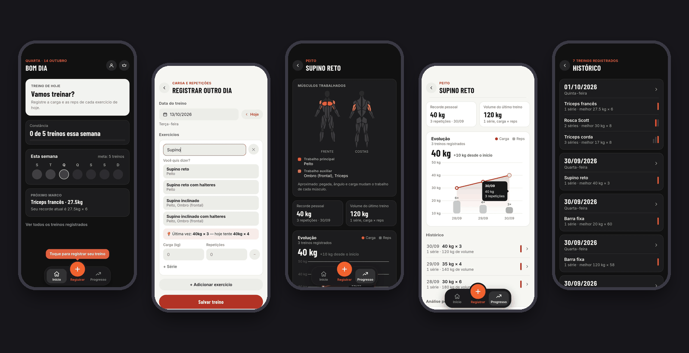
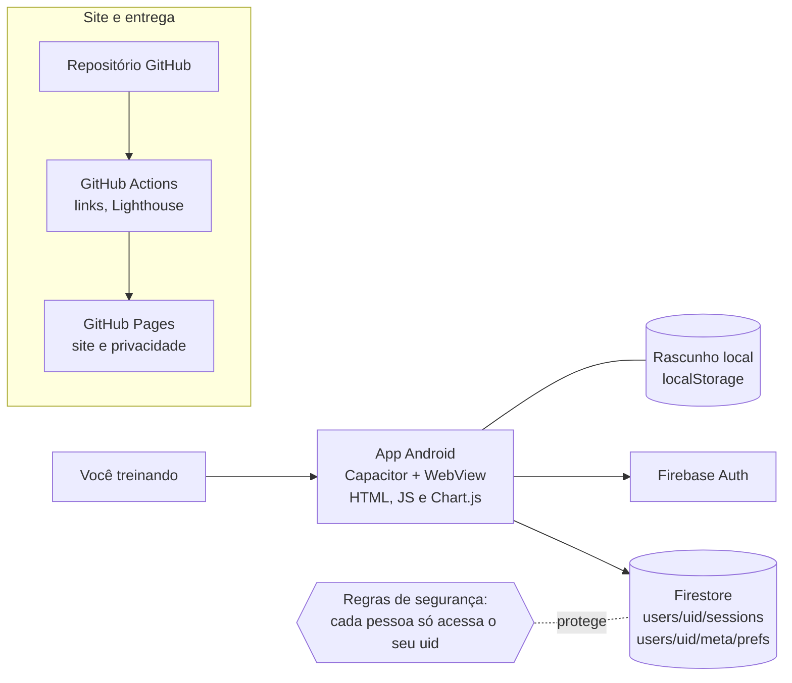
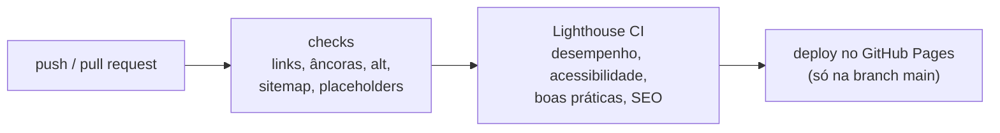

<div align="center">

# MaxProgress

**Diário de treino para Android: registre carga e repetições em segundos e acompanhe a sua evolução.**

[](https://andreyvid.github.io/maxprogress-site/)
[](https://github.com/Andreyvid/maxprogress-site/actions/workflows/site.yml)


[**Ver o site**](https://andreyvid.github.io/maxprogress-site/) · [Case study](https://andreyvid.github.io/maxprogress-site/case-study.html) · [Política de privacidade](https://andreyvid.github.io/maxprogress-site/privacidade.html)



</div>

## O que é este repositório

O **MaxProgress** é um app de academia que eu desenvolvo sozinho, em português. O **código do app é privado**; este repositório é o **site de apresentação** (e o meu portfólio): ele mostra o app com prints reais, conta as decisões por trás dele e reúne as páginas exigidas para publicar na Play Store.

Também é um projeto de prática de **entrega contínua**: o site tem testes automáticos, medição de qualidade e deploy sem etapas manuais.

## O que tem no site

- **Celular 3D que gira com a rolagem.** Cada tela do app aparece conforme você rola a página (CSS 3D + GSAP ScrollTrigger). Há uma versão própria para celular e uma versão simples, sem movimento, para quem prefere menos animação.
- **Tema escuro e claro.** O site e as telas do app seguem o tema escolhido. Um slider compara os dois temas do app na mesma tela.
- **Case study** do projeto: problema, decisões de arquitetura, o que deu errado e o que aprendi.
- **Páginas legais** em conformidade com a LGPD: política de privacidade e como excluir a conta e os dados.
- **Acessibilidade e desempenho:** navegação por teclado, textos alternativos, fontes locais e imagens otimizadas.

## O app

| | |
|---|---|
| **Registrar** | carga, repetições e séries por exercício, com busca que perdoa erros de digitação (acentos, plural, letras trocadas) |
| **Mapa de músculos** | mostra quais músculos cada exercício trabalha, principais e auxiliares |
| **Evolução** | gráfico de carga e repetições, com recorde pessoal e quanto você ganhou desde o início |
| **Histórico** | todos os treinos por dia, com as séries e a melhor marca |
| **Constância** | meta semanal e acompanhamento da semana na tela inicial |
| **Rascunho automático** | o treino em andamento é salvo e restaurado se o Android encerrar o app |

## Arquitetura



- **App:** Capacitor (WebView) para reaproveitar HTML, CSS e JavaScript no Android.
- **Dados:** Firebase Authentication e Cloud Firestore. As regras de segurança do banco garantem que cada conta só leia e escreva os próprios dados.
- **Site:** estático, sem build, publicado no GitHub Pages.

## Stack do site

HTML, CSS e JavaScript puros, sem framework e sem etapa de build. Animação com [GSAP](https://gsap.com) + ScrollTrigger (arquivos incluídos no repositório, em `js/vendor`). Fontes Inter e Barlow Condensed, servidas localmente. CI/CD com GitHub Actions.

## Qualidade e entrega

A cada `push`, o workflow [`site.yml`](.github/workflows/site.yml) roda três etapas em sequência:



- **checks** (`scripts/check-site.mjs`): falha se houver link ou âncora local quebrada, imagem sem `alt`, página fora do sitemap ou texto-modelo esquecido.
- **Lighthouse CI** (`lighthouserc.json`): acessibilidade, boas práticas e SEO precisam ficar acima do limite; desempenho emite aviso abaixo de 90.
- **deploy**: só acontece na `main`, e só se as etapas anteriores passarem.

Medição local, sem a compressão do servidor: desempenho 97–98, e 100 em acessibilidade, boas práticas e SEO.

## Decisões e desafios

Resumo; os detalhes estão no [case study](https://andreyvid.github.io/maxprogress-site/case-study.html).

- **Rascunho que sumia:** o Android encerrava a tela ao trocar de app. Passei a salvar o treino a cada alteração e restaurá-lo na volta.
- **Busca tolerante a erros:** normalização de acentos e plural, distância de edição e peso por prefixo.
- **Script de build que só rodava uma vez:** um ajuste no código nativo sumia depois de certas operações. Passou a rodar a cada sincronização.
- **Licenças de terceiros:** conferi a licença do mapa muscular e da base de exercícios antes de publicar e deixei os créditos dentro do app.
- **Menos é mais:** juntei telas que repetiam informação e deixei o app menor e mais direto.

## Estrutura do repositório

```
.
├── index.html               página principal
├── case-study.html          case study do projeto
├── privacidade.html         política de privacidade (LGPD)
├── excluir-conta.html       como excluir a conta e os dados
├── 404.html · robots.txt · sitemap.xml
├── css/style.css            estilos, temas e modos de animação
├── js/
│   ├── main.js              animação do celular (GSAP + ScrollTrigger)
│   ├── theme.js             tema, slider escuro × claro, ativar animação
│   └── vendor/              GSAP e ScrollTrigger
├── assets/                  logo, imagens, fontes e telas (dark/ e light/)
├── scripts/                 build do site e verificações
├── docs/                    arquitetura, guia de publicação e banner
├── lighthouserc.json        metas de qualidade do Lighthouse CI
└── .github/workflows/       pipeline de CI/CD
```

## Rodando localmente

Não precisa instalar nada. Abra o `index.html` no navegador ou sirva a pasta:

```bash
python3 -m http.server 8000
# abra http://localhost:8000
```

Para rodar as mesmas verificações do CI:

```bash
node scripts/check-site.mjs      # links, imagens, sitemap
bash scripts/build-site.sh       # monta a pasta _site/ que vai para o ar
```

## Mexendo no site

- **Trocar as telas:** cada tela tem uma versão escura e uma clara, com o mesmo nome, em `assets/screens/dark/` e `assets/screens/light/` (`.webp`, cerca de 780×1688). As duas devem ter o mesmo conteúdo, para o slider ficar alinhado. Antes de publicar, apague a barra de status do celular e dados pessoais (e-mail, nome).
- **Tema:** as cores ficam em variáveis no topo de `css/style.css`; `js/theme.js` alterna o tema e guarda a escolha.
- **Animação:** as constantes no topo de `js/main.js` controlam ritmo, distância e giro.
- **Publicar e domínio próprio:** veja [`docs/PUBLICAR.md`](docs/PUBLICAR.md).

## Licenças de terceiros

- **GSAP** e ScrollTrigger (`js/vendor`): licença "no charge" da GreenSock, em <https://gsap.com/standard-license>.
- **Inter** e **Barlow Condensed** (`assets/fonts`): SIL Open Font License 1.1 (arquivos de licença na pasta).

Fora os itens acima, o código, os textos e as imagens deste repositório são de minha autoria. Por ora não há licença de reuso: todos os direitos reservados.

## Próximos passos

- [ ] Pipeline de CI do app Android (build, testes e artefato a cada tag)
- [ ] Botão de excluir conta dentro do app
- [ ] Regras do Firestore versionadas e implantadas por pipeline
- [ ] Publicação na Play Store

## Autor

**Andreyvid** — estudante de Engenharia da Computação (8º semestre), buscando estágio ou vaga júnior em TI. Minha base é Java e o meu objetivo é migrar para DevOps e Cloud.

- GitHub: [@Andreyvid](https://github.com/Andreyvid)
- Contato do projeto: maxprogress.app@gmail.com
